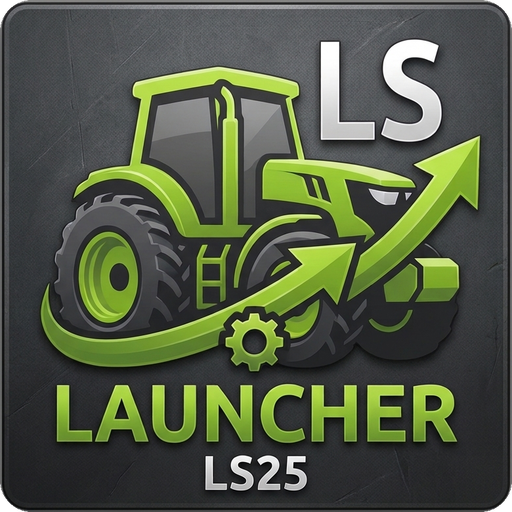

# Agri Nexus v1.0.1-beta

Freies Open-Source-Verwaltungstool für den Landwirtschafts-Simulator 25.



## Funktionen

- **Starten** – Start-Button, aktives Profil, Schnelleinstellungen (Dev Mode, Shader Cache leeren, Intro überspringen, Auto-Backup vor dem Start)
- **Hof Profile** – pro Profil eigener Mod-Ordner (wird in die `gameSettings.xml` eingetragen), fest zugeordnetes Savegame, Mod-Auswahl und Startoptionen
- **Mods & Assets** – Mod-Regal mit Icon, Name, Version, Modder und Fehlern je Mod; Mod-Ordner wird aus der `gameSettings.xml` gelesen
  - P2P-Sync für private ZIP-Mods per Raumcode, SHA-256-Abgleich und Fortschritt; einzelne Mods oder alle fehlenden ZIP-Mods auf einmal
  - Mod-Speicherübersicht mit Warnung für besonders große Dateien
  - Konflikt-Checker (Skript-Überschneidungen, doppelte Mods)
  - 1-Klick-Deaktivierung per `.bak`
  - ModHub-Versionsabgleich (experimentell)
  - Drag-&-Drop-Installer für `.zip`-Mods
- **Saves & Backups** – manuelle und automatische Backups, Liste mit Datum/Uhrzeit, 1-Klick-Wiederherstellung (mit Sicherheitskopie)
  - Savegame-Editor für numerische XML-Werte mit vollständigem Vorher-Backup und XML-Strukturdiagnose
- **Live & Werkstatt** – Companion-Webseite fürs lokale WLAN mit Savegame-/Hofdaten und optionalem Telemetrie-POST-Endpunkt
  - Dev-Makro-Deck, Controllerbelegungs-Snapshots und mehrere benannte `gameSettings.xml`-Grafik-Snapshots pro Profil
  - Mod-Bloat-Scanner für große ZIPs und Assets, Ladezeit-Hinweise aus `log.txt` sowie Modpack-Manifest-Export
- **Log-Analyse** – liest die Spiel-Log-Datei, übersetzt Fehler/Warnungen und ordnet sie Mods zu, optional live
- **Rechner** – Ertrag & Gewinn, Futterbedarf, Mischration, Arbeitszeit
- **Server Status** – GIANTS-Dienste und eigene Server mit Spieleranzahl, Map und Spielernamen (über die Statistik-Adresse des Dedicated Servers)
- **Screenshots** – Galerie für Bilder aus dem Spiel-Profilordner, inklusive Kopieren, Teilen, Kontext-Tags und Vorher/Nachher-Vergleich
- Discord Rich Presence mit Profilname, aktivem Spielstatus und Mod-Anzahl
- **Partner** – Partnerverzeichnis lädt `partners.json` kostenlos von GitHub, mit lokalem Offline-Cache; Änderungen brauchen kein neues App-Release. Bearbeiten kann nur, wer Schreibrechte am Repository hat.
- **RP & Party Network** – WebRTC-Lobbys, Whitelist/Regelbestätigung, Höfe/Rollen, virtuelle Konten, Fuhrparkmiete, LU-Preise, Feldnotizen, Lieferscheine und Event-/Schichtverwaltung
- **Admin-Savegame-Sync** – ruft eine konfigurierte HTTPS-Quelle minütlich ab, solange die RP-Ansicht geöffnet ist
- **Einstellungen** – Spiel-, Profil-, Backup- und Mods-Pfad; der Mods-Pfad wird in `gameSettings.xml` übernommen
- **Über uns**

## Partnerliste aktualisieren

Die zentrale Liste liegt in [`partners.json`](https://github.com/AgrarJulian/LS-Launcher/edit/main/partners.json). Füge einen Eintrag in `partners` ein und speichere die Datei auf `main`. Die App prüft die öffentliche GitHub-Datei beim Öffnen des Partner-Tabs und danach mindestens alle 15 Minuten; der Aktualisieren-Knopf lädt sofort. Offline verwendet die App den zuletzt gespeicherten Cache.

Ein Eintrag hat dieses Format:

```json
{
  "id": "partner-id",
  "title": "Partnername",
  "description": "Kurze Beschreibung",
  "url": "https://example.com/",
  "logo": "https://example.com/logo.png"
}
```

`logo` darf leer sein. Links müssen HTTPS-Adressen sein. GitHub-Schreibrechte schützen die zentrale Liste; die App selbst bietet anderen Nutzern keine Bearbeitungsfunktion.

## Entwicklung

Voraussetzung: [Node.js](https://nodejs.org) 20 oder neuer.

```bash
npm install
npm start          # Launcher im Entwicklungsmodus starten
```

## .exe erzeugen

```bash
npm run build            # portable .exe  ->  dist/Agri-Nexus-1.0.1-beta-x64.exe
npm run build:installer  # Setup-Installer (NSIS)
```

Der Build sollte unter Windows ausgeführt werden. Dort wird auch das Icon in die .exe eingebettet.

## Startoptionen

| Option | Startparameter |
| --- | --- |
| Dev Mode | `-cheats -console` |
| Intro überspringen | `-skipStartVideos` |
| Shader Cache leeren | löscht `shader_cache` im Profil-Ordner vor dem Start |
| Savegame direkt laden | `-autoStartSavegameId <Nr>` (experimentell) |

## Lizenz

[MIT](LICENSE) · Datenschutz: [PRIVACY.md](PRIVACY.md)

Agri Nexus ist ein inoffizielles Community-Projekt und steht in keinerlei Verbindung mit der GIANTS Software GmbH. „Landwirtschafts-Simulator“ und „GIANTS Software“ sind eingetragene Marken der GIANTS Software GmbH.
